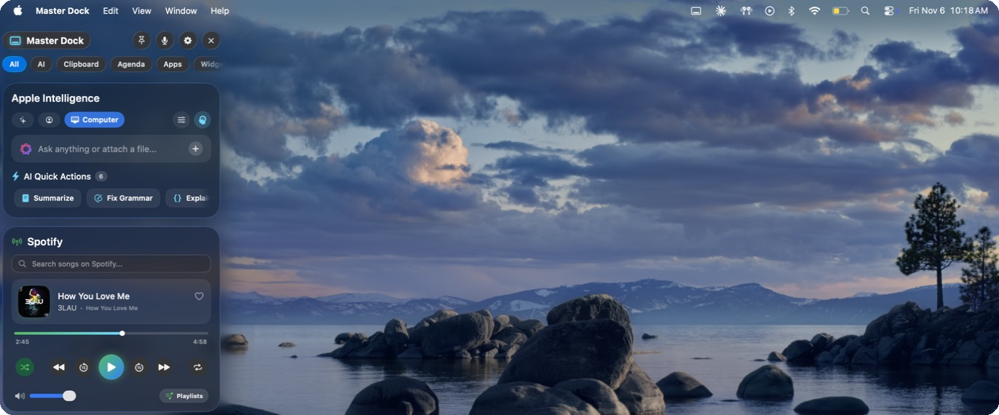
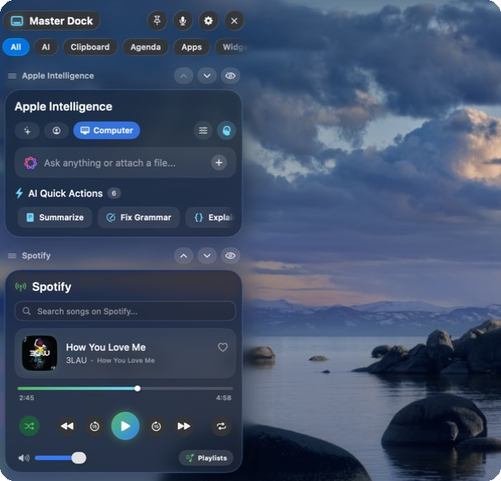
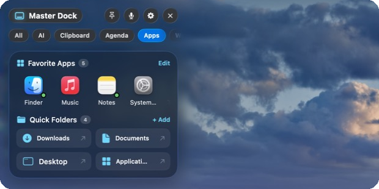
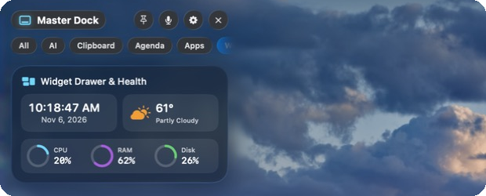

<div align="center">



# Master Dock

**A Liquid Glass sidebar for your Mac. AI, music, calendar, clipboard and quick tools, one swipe away.**


</div>

---

## What is it?

Master Dock is a panel that slides in from the left side of your screen. Put two fingers on the left edge of your trackpad and swipe right, or press **⇧⌘Space**. Everything you reach for all day lives in one place: an AI assistant, your music, today's events, your clipboard, favorite apps and more.

It is built to feel like part of macOS. The cards use Apple's Liquid Glass, the edges blur into your wallpaper like Notification Center, and every movement is tuned to follow your fingers smoothly.

## Features

### 🤖 Apple Intelligence, built in
Chat with Apple's on device AI. Nothing leaves your Mac.

* **Three modes:** General for normal questions, Personal where it learns your name and how you like answers, and Computer where it can see what's on your dock, the app you're in, or text you've highlighted. It only sees what you allow.
* **Memory (optional):** turn it on and it remembers past chats. Ask about something from last week and it knows what you mean. One button forgets everything.
* **Voice mode:** swipe farther, or press **⌥⇧⌘Space**, and just talk.
* **Quick actions:** summarize, fix grammar, explain code and more in one click.

### 🎵 Music
Control Spotify or Apple Music: play, skip, scrub, like, search and playlists.

### 📅 Calendar
* See today's events from iCloud and every Google account on your Mac, all in one list.
* Add events by just typing, like *"Study session Friday 4pm for 2 hours"*. They save to your real calendar and sync to your phone.
* A **Join** button shows up only when an event has a real Zoom, Meet, Teams, Webex or FaceTime link.

### 📋 Clipboard history
* **Pin** things you paste a lot, like prompts, so they stay at the top.
* Delete one item at a time, or clear everything except your pins.
* **Private by default:** it asks before saving anything, and it skips passwords copied from password managers.

### 🧩 Make it yours



* Click **Edit Widgets** to reorder, hide or add cards.
* Double click any card title to rename it.
* Extra widgets you can add: **Quick Notes, Focus Timer, Calculator and World Clock**.
* Pick your own **favorite apps** and **quick folders**.

<br clear="right">

### 🛠 Everyday tools

<p>
  
  
</p>

* Favorite apps with a green dot when they're running.
* One click folders like Downloads and Documents.
* Clock, local weather, and live CPU, RAM and disk use.

## Privacy

* Everything is saved on your own Mac, in your own user account. Nothing is uploaded.
* The AI runs on device with Apple Intelligence.
* If you add an OpenAI or Gemini key, it is stored in the **macOS Keychain**, not in a plain text file.
* Every permission (calendar, microphone, location) is optional and explained on the welcome screen.

## Battery friendly
When the dock is closed, music and system checks stop completely. The few things that must keep running, like the clipboard watcher, are tiny and let macOS group them with other work so your Mac can rest.

## Keyboard shortcuts

| Shortcut | What it does |
| --- | --- |
| **⇧⌘Space** | Open or close the dock |
| **⌥⇧⌘Space** | Open voice mode |

You can turn shortcuts off by right clicking the Master Dock icon in the menu bar.

## Install

### Download (Apple silicon Macs)
1. Click the green **Code** button above, then **Download ZIP**, and unzip it.
2. Move **MasterDock.app** from the folder into your Applications folder and open it.
3. macOS will say it can't check the app, because it isn't from the App Store yet. Open **System Settings > Privacy & Security**, scroll down and click **Open Anyway**. You only do this once.
4. A short welcome screen walks you through the rest.

### Build it yourself
You need macOS 14 or newer and Xcode command line tools. Apple Intelligence needs an Apple silicon Mac on macOS 26.

```bash
git clone https://github.com/nathantang888/Master-Dock.git
cd Master-Dock
bash rebuild.sh
```

`rebuild.sh` builds the app, runs all the tests, packages it and opens it.

## How it's built

| Part | What it does |
| --- | --- |
| `MasterDockCore` | Trackpad gestures, the sliding glass window, shortcuts, Keychain |
| `MasterDockServices` | Calendar, music, clipboard, apps, folders, weather, stats |
| `MasterDockAI` | Apple Intelligence chat, modes, memory, voice |
| `MasterDockUI` | Every card, the Liquid Glass theme, settings and welcome screen |
| `MasterDockApp` | Starts the app and connects everything |

Written in Swift and SwiftUI with Swift Package Manager. 67 tests cover gestures, motion, calendar, the calculator, clipboard privacy and AI memory.

---

<div align="center">
Made by <a href="https://github.com/nathantang888">Nathan Tang</a>
</div>
